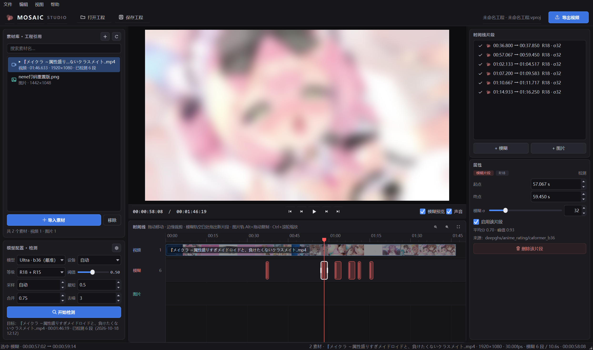
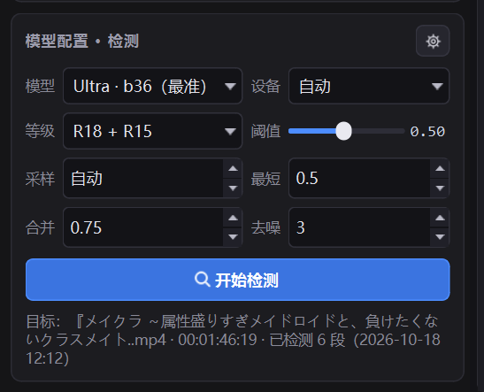
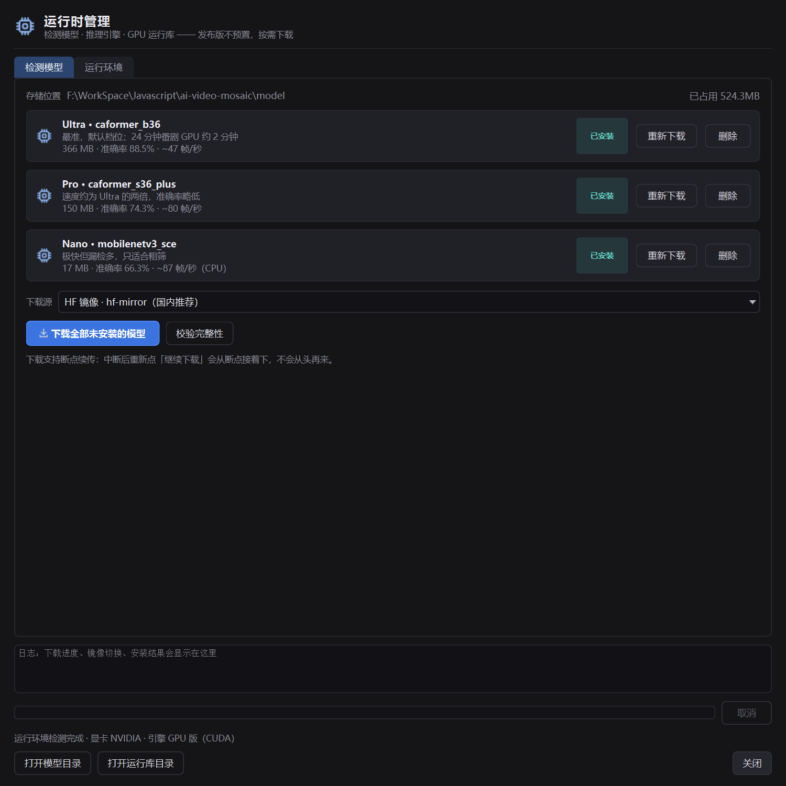
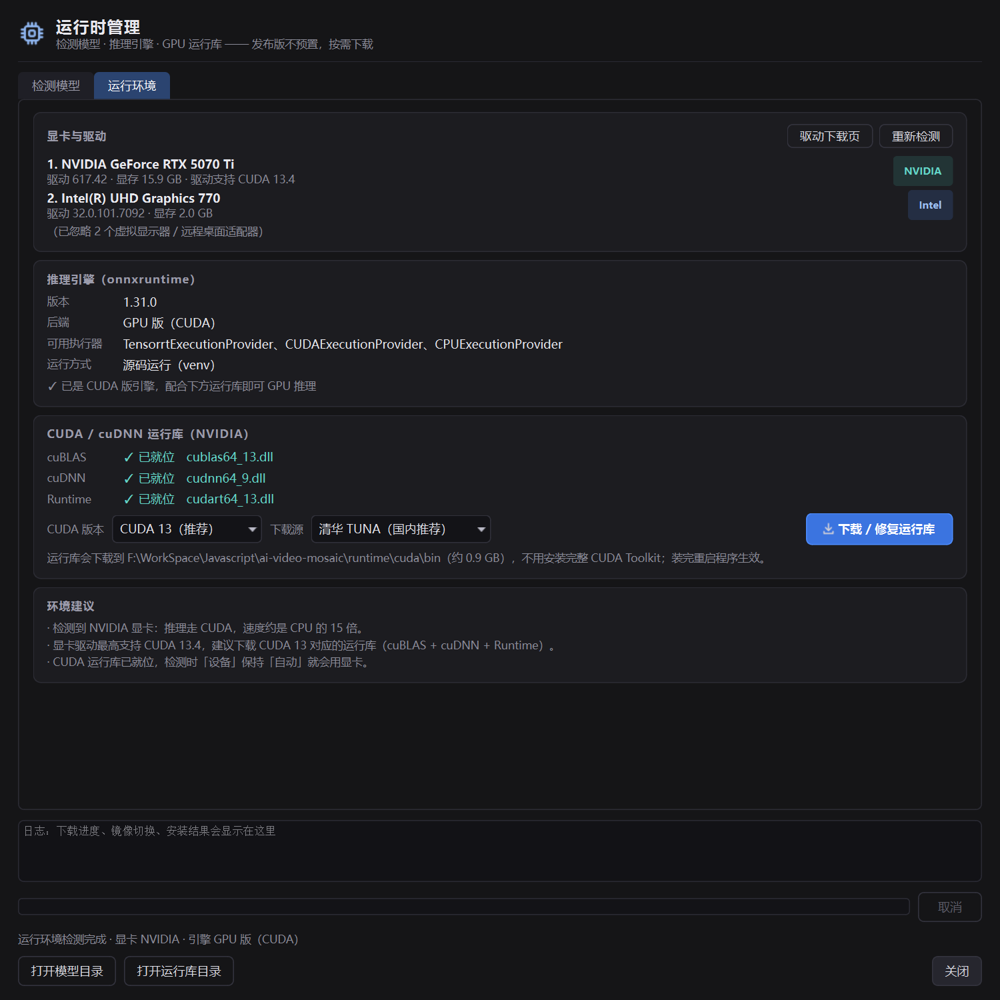

# Mosaic Studio · 本地视频智能打码工作室

用本地 AI 模型扫描视频里需要打码的片段，在**类 Premiere 的时间线**上逐段确认、微调、叠加遮挡图，
最后直接导出打好模糊的成片。**全程离线，不联网、不上传**，有 N 卡时自动走 GPU 推理。




> 界面：左侧素材库与检测设置、中间节目监视器与三轨时间线、右侧片段列表与属性面板。
> 截图中的红色片段就是检测出来的打码区间，监视器正在实时预览模糊效果。

---

## 目录

- [功能特性](#功能特性)
- [快速开始](#快速开始)
- [界面与操作](#界面与操作)
- [运行时管理（模型 / GPU）](#运行时管理模型--gpu)
- [工程文件](#工程文件vproj)
- [导出说明](#导出说明)
- [关于模型](#关于模型)
- [检测参数](#检测参数)
- [目录结构](#目录结构)
- [调参建议](#调参建议)
- [常见问题](#常见问题)
- [许可证](#许可证)

---

## 功能特性

### 1. 本地 AI 检测，一键扫出所有敏感片段

内置动漫专用分级模型（`deepghs/anime_rating`，ONNX，无需 PyTorch）。选中素材 → 选档位 → 点「开始检测」，
进度条实时显示帧数、命中数、剩余时间，随时可取消。检测完的**每一段起止时间、分数、模型参数都直接写进工程**，
重新打开工程不用再扫一遍。

- 三档模型可切换：`Ultra`（88.5% 准确率）/ `Pro`（快一倍）/ `Nano`（极快但漏检多）
- 两种判定等级：`R18 + R15`（含擦边）/ `仅 R18`（只看露骨，误报更少）
- 抽帧 + 多数投票去噪，孤立的单帧误判会被否掉；相邻片段自动合并，碎段自动丢弃
- 24 分钟番剧在 GPU 上约 2 分钟扫完

<table>
<tr>
<td width="40%"></td>
<td width="60%"><b>检测设置面板</b><br>模型 / 设备 / 等级 / 阈值 / 采样 / 最短时长 / 合并间隔 / 去噪窗口，每个参数都有悬停说明。<br><br>检测结果直接变成时间线上的红色片段，不需要额外的 JSON 文件和预览图目录。</td>
</tr>
</table>

### 2. 类 Premiere 的三轨时间线

视频轨 / 模糊轨 / 图片轨三条轨道，检测结果自动铺到模糊轨上，之后全靠手动微调：

| 操作 | 效果 |
|---|---|
| 拖动片段 | 移动时间（自动吸附到相邻片段 / 播放头 / 首尾） |
| 拖片段两端 | 裁剪入点 / 出点 |
| 模糊轨空白处拖拽 | 直接画出新的模糊片段（手动补漏检） |
| 图片轨 `Alt + 拖动` | 复制图片片段（和 Pr 一样） |
| 右键片段 | 启用 / 禁用、重置模糊强度、删除、图片片段「以此图对齐所有模糊片段」 |
| 滚轮 / `Shift + 滚轮` / `Ctrl + 滚轮` | 横向滚动 / 纵向滚动 / 以鼠标位置缩放 |
| 双击标尺 | 时间线适应窗口 |

右侧属性面板可以改每段的起止时间、模糊强度 σ、启用状态，滑块和数字输入框双向同步。

### 3. 图片遮挡 / 贴纸叠加

按 `I` 或点「+ 图片」，选一张图（自动加入素材库）→ 作为叠加片段放到播放头位置。
属性里可调**缩放、水平 / 垂直位置、不透明度**。右键「以此图片对齐所有模糊片段」，
可以按每段打码的时间各复制一张，适合"每个片段都盖同一张遮挡图"。

### 4. 工程只存引用，素材放哪都行

素材以**引用**方式记进工程：视频和图片留在原地，工程文件只有几十 KB。
绝对路径失效时会自动尝试相对路径（工程和素材一起搬家也能找回）；实在找不到，
素材库会标红提示「⚠ 文件缺失」，右键「重新定位…」即可，所有引用这张图的图片片段会跟着换路径。

### 5. 一次编码导出，支持 NVENC 硬件加速

内置 ffmpeg 7.1（带 libx264 / libx265 / NVENC / AAC），模糊与图片叠加**烧进画面、只编码一次**：

- 滤镜链 `gblur + enable='between(t,a,b)'` 做分段模糊，`overlay` 做图片叠加
- 编码器自动探测：`h264_nvenc` / `hevc_nvenc` / `libx264` / `libx265`
- 音频默认直接复制，不重编码
- 实测 2 分钟 720p 用 NVENC 约 5 秒

### 6. 运行时管理：模型和 GPU 环境在界面里下

发布包不预置模型和 CUDA 运行库（合起来 1.5 GB+），第一次使用时在界面里按需下载：
支持 hf-mirror / HuggingFace 官方 / 自定义镜像，**断点续传**，失败自动换源。

<p>


</p>

左：检测模型页（三档位的体积、准确率、安装状态，下载 / 继续下载 / 删除 / 校验完整性）。
右：运行环境页（显卡与驱动、推理引擎、CUDA / cuDNN 运行库逐项体检，缺什么一键补）。

---

## 快速开始

### 源码运行（推荐，能用满 GPU）

```bat
build.bat          :: 首次会建 .venv、装依赖、下模型和 ffmpeg（也可手动 pip install -r requirements.txt）
run_gui.bat        :: 启动编辑器
```

也可以带工程启动：

```bat
run_gui.bat --project projects\我的工程.vproj
```

想直接用 GPU 推理（比 CPU 快 15 倍以上）：

```bat
:: 1. 卸掉 CPU 版（两个包不能共存）
.venv\Scripts\python -m pip uninstall -y onnxruntime

:: 2. 装 GPU 版 + CUDA 13 / cuDNN 9 运行库（走 pip，不用装 3GB 的 CUDA Toolkit）
.venv\Scripts\python -m pip install -r requirements-gpu.txt
```

### 打包成独立程序

双击 `build.bat`，完成后得到：

```
dist\MosaicStudio\
├─ MosaicStudio.exe      ← 双击运行
├─ _internal\            ← 运行时依赖（PySide6 / onnxruntime / cv2 / QtMultimedia）
├─ bin\ffmpeg.exe        ← 内置 ffmpeg（导出用）
├─ projects\             ← 默认工程目录（*.vproj）
└─ README.md
```

整个 `dist\MosaicStudio` 文件夹是**便携**的，拷到别的机器直接能跑。素材不用放进来，
工程里存的是素材的绝对路径（同时记一份相对路径，工程整体搬家时能自动找回）。

> **模型和 CUDA 运行库默认不打进发布包**（加起来 1.5 GB 以上）。第一次运行时点
> 「模型配置」右上角的**齿轮 → 运行时管理**，在界面里选镜像下载即可：
> 模型落到 `dist\MosaicStudio\model\`，CUDA DLL 落到 `dist\MosaicStudio\runtime\cuda\bin\`。
> 想直接打包进去就 `set BUNDLE_MODEL=1` / `set BUNDLE_CUDA=1` 后再跑 `build.bat`。

> **关于打包版的 GPU**：`build.bat` 会用 venv 里的 onnxruntime 打包，所以只要 venv 里是
> GPU 版（`requirements-gpu.txt`），exe 就带 CUDA provider；缺的只是 CUDA / cuDNN 的 DLL，
> 用户在「运行时管理 → 运行环境」里一键下载即可（约 0.9 GB，不用装完整 CUDA Toolkit）。

---

## 界面与操作

启动后会先弹出**工程选择页**：最近工程列表（双击打开）、新建工程、打开其他工程。
选中工程后才进入编辑器：

```
┌────────────┬─────────────────────────────┬──────────────┐
│ 素材库      │  节目监视器（实时模糊预览）    │ 时间线片段    │
│ 工程引用    ├─────────────────────────────┤ 属性（微调）  │
│            │  时间线（视频 / 模糊 / 图片）  │              │
│ 模型配置    │                             │              │
└────────────┴─────────────────────────────┴──────────────┘
```

### 完整流程

1. **新建 / 打开工程**：启动页选一个工程；编辑器里 `Ctrl+N` 新建、`Ctrl+O` 打开。
2. **导入素材**：左侧「导入素材」（`Ctrl+I`，可多选）把**任意位置**的视频或图片加进工程，
   也可以直接把文件拖到时间线上。素材库显示每个素材的类型、时长/分辨率、检测状态。
   - **双击视频素材** → 加载到工作区（节目监视器 + 时间线）
   - **双击图片素材** → 作为叠加片段放到播放头位置（遮挡、贴纸都行）
3. **检测**：选中视频素材后，左下选模型档位 / 设备 / 等级，调好阈值 → 点「开始检测」。
   每个参数悬停都有说明。进度条实时显示帧数、命中数、剩余时间，中途可以取消。
   **检测结果（模型、参数、每段起止与分数）直接写进工程**，不再生成 JSON 文件和预览图；
   检测完成会自动保存工程。模型没下载时点检测会提示并直接跳到运行时管理。
4. **微调**：
   - 时间线上拖动片段可移动，拖两端可裁剪（自动吸附到相邻片段 / 播放头 / 首尾）；
   - 模糊轨空白处**拖拽可直接画出新片段**（手动补充漏检）；
   - 选中片段后在右下「属性」里改起止时间、模糊强度 σ、启用/禁用；
   - `Delete` 删除选中片段，右键菜单可禁用、重置强度、删除；
   - 片段列表里每行前有勾选框，取消勾选等于临时关掉这一段。
5. **加图片**：按 `I` 或点「+ 图片」，选一张图（会自动加入素材库）→ 作为叠加片段放到播放头位置，
   属性里可调缩放、水平/垂直位置、不透明度。这些参数**既拖滑块也能直接输数字**。
   图片轨上 **Alt + 拖动** = 复制出一个新片段（和 Pr 一样）。
   右键图片片段 → **「以此图片对齐所有模糊片段」**：清掉其它图片片段，然后按每个模糊片段的
   起止时间各复制一张（位置/缩放/透明度沿用这张图的设置），适合"每段都盖同一张遮挡图"。
6. **保存工程**：`Ctrl+S`（或工具栏「保存工程」）。工程记录素材引用 + 所有片段，
   下次打开继续调。保存成功后主窗口底部会弹出「工程已保存 · 文件名」的提示条。
7. **导出**：右上角「导出视频」→ 设置编码器 / 质量 / 预设 / 容器 / 音频 / 分辨率 → 开始导出。
   模糊和图片叠加会**烧进画面**，音频默认直接复制。

> **预览有声音**：节目监视器下方有「声音」勾选框，播放时用 QtMultimedia 播原声，
> 与画面自动同步（偏差超过 0.4s 会自动纠正）。音频只用于预览，不影响导出。

### 快捷键

| 键 | 功能 |
|---|---|
| 空格 | 播放 / 暂停 |
| ← / → | 上一帧 / 下一帧 |
| Home / End | 跳到开头 / 结尾 |
| B | 在播放头添加模糊片段 |
| I | 添加图片到时间线 |
| Delete | 删除选中片段 |
| F | 时间线适应窗口 |
| Ctrl+N / Ctrl+O | 新建工程 / 打开工程 |
| Ctrl+S / Ctrl+Shift+S | 保存工程 / 另存为 |
| Ctrl+I / Ctrl+E | 导入素材 / 导出视频 |
| Ctrl+M | 运行时与模型管理 |

### 素材缺失怎么办

工程只记引用，所以素材被移动、改名、删除后路径会失效：

- 打开工程时会弹「素材缺失」对话框，可以逐个**重新定位**，也可以「稍后处理」；
- 素材库里缺失的素材标红显示 `⚠ 文件缺失`，右键「重新定位…」随时补；
- 双击缺失素材、或在缺失状态下开始检测，都会先提示你重新定位；
- 重新定位后，所有引用这张图片的图片片段会自动跟着换路径。

---

## 运行时管理（模型 / GPU）

「模型配置」卡片右上角的**齿轮**（或菜单「文件 → 运行时与模型管理…」，`Ctrl+M`）打开。

**检测模型页**

| 功能 | 说明 |
|---|---|
| 三个档位 | Ultra / Pro / Nano，显示体积、准确率、速度与安装状态 |
| 下载 / 继续下载 | 断点续传，`.part` 临时文件，中断后接着下 |
| 删除 | 释放空间（不影响已有工程和检测结果） |
| 下载源 | hf-mirror（默认，国内快）/ HuggingFace 官方 / 自定义镜像地址 |
| 校验完整性 | 检查 `model.onnx` + `meta.json` 是否完整可读 |
| 存储位置 | 默认 `<程序目录>\model`；程序目录不可写时自动退回 `%LOCALAPPDATA%\MosaicStudio\model` |

**运行环境页**

- **显卡与驱动**：识别 NVIDIA / AMD / Intel（WMI + `nvidia-smi`），显示型号、驱动版本、
  显存、驱动支持的最高 CUDA 版本；虚拟显示器自动折叠
- **推理引擎**：onnxruntime 版本、是 CPU 版还是 GPU 版、可用执行器（CUDA / DirectML / TensorRT）
- **CUDA / cuDNN 运行库**：逐个显示 cuBLAS / cuDNN / cudart 是否就位（含路径），
  缺失时可一键下载 —— 从 PyPI 镜像取 `nvidia-*` wheel，把 DLL 解压到
  `<程序目录>\runtime\cuda\bin`，**不用装 3 GB 的 CUDA Toolkit**；CUDA 13 / 12 可选
- **环境建议**：按显卡厂商给出下一步该做什么

显卡厂商不同，走的后端也不同：

| 显卡 | 推理后端 | 需要准备 |
|---|---|---|
| NVIDIA | CUDA | GPU 版 onnxruntime + CUDA/cuDNN 运行库（界面里一键下） |
| AMD | DirectML | `onnxruntime-directml`（Windows 上 ORT 不支持 ROCm） |
| Intel | DirectML / CPU | `onnxruntime-directml`，核显提升有限 |
| 无独显 | CPU | 无需额外组件，建议采样降到 2、模型选 Pro |

> 打包版不能在线替换 onnxruntime 本体（DLL 已被占用），所以「安装 GPU 版引擎」只在源码
> 运行（venv）时可用；打包版请在打包时用 GPU 版 onnxruntime，运行库仍可在界面里下载。

---

## 工程文件（`*.vproj`）

工程就是一个 JSON 文件，默认放在 `projects\`，可以放到任意位置（建议跟素材放一起）：

```json
{
  "format": "mosaic-project",
  "version": 2,
  "name": "示例工程",
  "active_id": "m1a2b3c4",
  "assets": [
    {
      "id": "m1a2b3c4",
      "kind": "video",
      "path": "D:\\素材\\第01话.mp4",
      "rel": "..\\素材\\第01话.mp4",
      "duration": 122.2, "fps": 30.0, "width": 1280, "height": 720,
      "detect": {
        "scanned_at": "2026-10-18T10:12:33",
        "model": { "name": "deepghs/anime_rating/caformer_b36", "variant": "ultra",
                   "labels": ["safe", "r15", "r18"], "provider": "CUDAExecutionProvider" },
        "settings": { "level": "all", "threshold": 0.5, "min_duration": 0.5, "gap": 0.75 },
        "summary": { "segment_count": 9, "nsfw_seconds": 17.5, "max_score": 1.0 }
      },
      "blurs": [
        { "id": "b1", "start": 45.0, "end": 48.5, "label": "r15",
          "score": 0.85, "peak": 1.0, "radius": 32.0, "enabled": true, "source": "detect" }
      ],
      "images": [
        { "id": "i1", "asset_id": "m9f8e7d6", "path": "D:\\素材\\sticker.png",
          "start": 45.0, "end": 48.5, "scale": 1.0, "x": 0.5, "y": 0.5,
          "opacity": 1.0, "enabled": true }
      ]
    },
    { "id": "m9f8e7d6", "kind": "image", "path": "D:\\素材\\sticker.png" }
  ]
}
```

- `assets`：素材引用列表，`kind` 为 `video` / `image`；每个视频素材**自带**时间线片段和检测记录。
- `path` 是绝对路径，`rel` 是相对工程文件的路径——绝对路径失效时程序会尝试 `rel`。
- `blurs[].source`：`detect`（检测生成，重新检测会被替换）或 `manual`（手工添加，永远保留）。
- 没有检测结果 JSON、没有预览图目录，全部在这一个文件里。

> 旧版工程的 `*.vproj.json`（单视频 + `json_path` 格式）可以直接打开，会自动转换成新格式，
> 原来的模糊/图片片段都会保留。

---

## 导出说明

- **ffmpeg 已经内置在 `bin/ffmpeg.exe`**（FFmpeg 7.1，带 libx264 / libx265 / NVENC / AAC），
  程序优先用它，开箱就能硬件编码。需要重装或换版本时跑 `python download_ffmpeg.py`。
- 滤镜链用 `gblur` + `enable='between(t,a,b)'` 实现分段模糊，图片用 `overlay` 叠加，
  画面只编码一次（实测 2 分钟 720p 用 NVENC 约 5 秒）。
- 编码器会自动探测当前 ffmpeg 支持哪些：`libx264` / `h264_nvenc` / `libx265` / `hevc_nvenc`。
  有 N 卡且版本 ≥ 5.0 时默认选中 `h264_nvenc`；如果指定的 ffmpeg 太老（比如 2018 年的构建），
  NVENC 接口对不上新显卡，界面会自动禁用它并提示改用 x264 / x265。
- 默认输出到源视频同目录的 `<原名>_blurred.mp4`，可以在对话框里改。
- 机器上完全没有 ffmpeg 时，会退回内置 OpenCV 逐帧渲染：能出片，但**没有音轨**、只能 mp4v，
  仅作应急。

---

## 关于模型

用的是动漫专用分级模型 `deepghs/anime_rating`（MIT，ONNX，无需 PyTorch）：

| 档位 | 模型 | 体积 | GPU (RTX 5070 Ti) | CPU | 测试集准确率 |
|---|---|---|---|---|---|
| `ultra`（默认） | `caformer_b36` | 366 MB | ~47 帧/秒 | ~2 帧/秒 | **88.5%** |
| `pro` | `caformer_s36_plus` | 150 MB | ~80 帧/秒 | ~5 帧/秒 | 74.3% |
| `nano` | `mobilenetv3_sce` | 17 MB | — | ~87 帧/秒 | 66.3% |

> **默认档位是怎么定的？**
> 最早用 nano，结果 00:52–00:53 那段露骨镜头它给 0.00（pro 给 1.00），漏检了。
> 换 pro 后没问题，但同仓库里还有个更大的 `caformer_b36`，官方准确率 88.5%（pro 是 74.3%）。
> 实测它还能找出 pro 漏掉的 00:24.5 内衣物镜头，同时避开了 00:110 附近海报的误报
> （代价是在 00:36.5 男主镜头上误报了一次）。所以默认用 ultra，24 分钟番剧 GPU 上约 2 分钟。

- 模型出处：<https://huggingface.co/deepghs/anime_rating> ，默认从 hf-mirror 镜像下载到
  `model/anime_rating/`，下载完即可离线使用。
- 发布版**不预置模型**：首次使用时在「模型配置 → 齿轮 → 运行时管理 → 检测模型」里勾选要下的档位
  （也可以只下 Ultra，其余随时补）。下载走镜像、支持断点续传，失败会自动换下一个镜像。
- 输出三类概率：`safe` / `r15` / `r18`。
  - `R18 + R15` 模式：分数 = `P(r15) + P(r18)` = `1 - P(safe)`
  - `仅 R18` 模式：分数 = `P(r18)`

**关于"是不是每帧都检测了"**：不是。默认按 **GPU 4 fps / CPU 2 fps** 抽帧（30fps 的视频相当于
每 7.5 / 15 帧取 1 帧），这是速度与召回的折中。想更密可以把「采样」调到 8（GPU 上依然很快）。
真正决定"能不能检出"的往往是模型本身：那次漏检的帧**确实被采样到了**，只是 nano 给了 0.00。

**为什么不用大语言模型（VLM）？** 这类逐帧判定，小分类模型的准确率和速度都明显优于多模态
大模型（后者跑视频基本不可用）。

> ⚠️ 客观限制：动漫的 safe/r15/r18 边界本身就模糊，官方 README 也说明这个模型只能做"粗略判断"。
> 转场特效、字幕卡、海报等画面偶尔会误报 —— 好在时间线上点一下就能看到对应画面，扫一眼就能判断真假。

---

## 检测参数

界面左下角，全部有鼠标悬停说明。

| 参数 | 默认 | 说明 |
|---|---|---|
| 模型 | `ultra` | `ultra` 最准 / `pro` 快一倍 / `nano` 极快但漏检多 |
| 设备 | 自动 | 自动 = 有 CUDA 就用 GPU；也可强制 `GPU` / `CPU` |
| 等级 | `R18 + R15` | `R18 + R15`=含擦边；`仅 R18`=只看露骨（误报更少） |
| 阈值 | 0.50 / 0.40 | 分数门槛，越低越敏感。`仅 R18` 时自动降到 0.40 |
| 采样 | 自动 | 每秒采样帧数，0=自动（GPU 4 / CPU 2） |
| 最短 | 0.5 s | 短于该秒数的片段丢弃 |
| 合并 | 0.75 s | 间隔小于该值的片段合并 |
| 去噪 | 3 帧 | 多数投票窗口，否决孤立的单帧误判；越大越保守 |

---

## 目录结构

```
ai-video-mosaic/
├─ projects/               # 默认工程目录（*.vproj，可用任意位置）
├─ bin/
│  └─ ffmpeg.exe           # 内置 ffmpeg（导出用，带 libx264/x265/NVENC）
├─ model/                  # 检测模型（运行时可下载，发布版不预置）
│  └─ anime_rating/
│     ├─ caformer_b36/        # ultra 档（默认）
│     ├─ caformer_s36_plus/   # pro 档
│     └─ mobilenetv3_sce/     # nano 档
├─ runtime/cuda/bin/       # 运行时下载的 CUDA / cuDNN DLL（可选）
├─ docs/                   # README 用截图
├─ src/
│  ├─ paths.py             # 路径解析（源码 / exe，含模型与运行库目录）
│  ├─ gpu.py               # CUDA DLL 目录准备
│  ├─ net.py               # 下载器（断点续传 / 镜像 / 取消）
│  ├─ models.py            # 检测模型清单、状态、下载与删除
│  ├─ runtime_info.py      # 显卡 / 驱动 / onnxruntime / CUDA 运行库探测
│  ├─ runtime_pkgs.py      # PyPI 镜像 wheel 解析与安装（CUDA / DirectML）
│  ├─ video.py             # 视频探测、按采样率抽帧
│  ├─ detector.py          # ONNX 推理（CUDA / DirectML / CPU）
│  ├─ segments.py          # 逐帧判定 + 多数投票去噪 + 片段合并
│  ├─ util.py              # 时间格式化
│  └─ gui/                 # 编辑器
│     ├─ app.py            # 启动入口 / 启动页调度
│     ├─ startup.py        # 启动页（选工程）+ 素材缺失对话框
│     ├─ mainwindow.py     # 主窗口，串起工程 / 素材 / 检测 / 导出
│     ├─ projects.py       # 工程目录、最近工程、工程摘要
│     ├─ model.py          # 工程 / 素材 / 片段数据模型（含旧工程迁移）
│     ├─ player.py         # 解码线程 + 监视器（实时模糊/图片/声音）
│     ├─ timeline.py       # 时间线控件（拖拽 / 裁剪 / 缩放 / 吸附）
│     ├─ panels.py         # 素材库、检测设置、片段列表、属性、导出对话框
│     ├─ runtime_dialog.py # 运行时管理（模型下载 / GPU 环境 / 运行库）
│     ├─ toast.py          # 底部提示条（保存成功等）
│     ├─ widgets.py        # 通用两行列表项
│     ├─ scan.py           # 检测流程（返回结果，不落盘）
│     ├─ exporter.py       # ffmpeg 滤镜链导出 + OpenCV 兜底
│     ├─ icons.py          # 矢量图标
│     └─ theme.py          # 深色主题
├─ main_gui.py             # 程序入口
├─ download_model.py       # 命令行下模型（备用，界面里也能下）
├─ download_ffmpeg.py      # 下载 / 更新内置 ffmpeg
├─ build.bat               # 一键打包 dist\MosaicStudio
├─ run_gui.bat             # 源码方式启动
└─ requirements.txt
```

> 仓库里**不包含**任何模型权重、ffmpeg 二进制、素材与工程文件，这些都在 `.gitignore` 里，
> 首次运行时按需下载。

---

## 调参建议

| 现象 | 调整 |
|---|---|
| 漏报（明显画面没检出） | 确认没在用 `nano`（默认已是 ultra）；再把「采样」调到 8、阈值 0.4、去噪 1 |
| 误报太多（字幕卡、海报被标红） | 在时间线上点开对应片段确认画面；仍嫌多就把阈值调到 0.65 |
| 只要露骨内容 | 等级选「仅 R18」（阈值会自动降到 0.4） |
| 太慢 | 确认左下「设备」显示 GPU；或换 `pro` / `nano`、采样调到 2 |
| 片段被切碎 | 把「合并」加到 1.5 |
| 想重新检测 | 直接再点「开始检测」，检测片段会被替换，手工片段保留 |

---

## 常见问题

**Q：素材被移动了，工程打不开画面？**
素材库会标红显示缺失，右键「重新定位…」选新路径即可；打开工程时也会自动弹提示。
重新定位后所有引用都会跟着更新。

**Q：工程能不能拷到别的电脑？**
可以。工程里同时存了绝对路径和相对路径，若把素材和工程一起搬（保持相对位置），
打开时会自动用相对路径找回。素材完全不在时按上面「重新定位」处理。

**Q：预览没声音？**
需要 `PySide6-Addons`（提供 QtMultimedia）：`.venv\Scripts\python -m pip install pyside6-addons`。
装上后勾选监视器下方的「声音」即可。没装也能正常编辑和导出，只是预览无声。

**Q：怎么确认真的在用显卡？**
按 `Ctrl+M` 打开运行时管理：「运行环境」页会直接显示识别到的显卡、驱动、onnxruntime 是
CPU 版还是 GPU 版、CUDA 运行库是否就位。检测时也可以另开窗口跑 `nvidia-smi` 看显存占用。
缺运行库时会自动回退 CPU，不会崩。

**Q：提示 CUDA 初始化失败 / 运行库不完整？**
打开运行时管理 →「运行环境」→ 点「下载 / 修复运行库」，装完重启程序即可；
也可以先把「设备」改成 CPU 应急。

**Q：AMD / Intel 显卡能用吗？**
能，但走 DirectML 而不是 CUDA。运行时管理里装 `onnxruntime-directml`，把「设备」选成
「GPU · DirectML」。核显提升有限，独显（Radeon）会明显一些。

**Q：报错"还没有下载检测模型"？**
打开「模型配置」右上角齿轮 →「运行时管理 → 检测模型」，勾选档位下载（默认 Ultra 最准）。
打包版确认 `model\` 和 `MosaicStudio.exe` 在同一层目录。

**Q：模型下载失败 / 想换镜像？**
运行时管理里「下载源」可以选 hf-mirror（默认）/ HuggingFace 官方 / 自定义地址；
下载支持断点续传，中断后点「继续下载」会接着下，不用从头来。
命令行也可以用：

```bat
python download_model.py --mirror https://hf-mirror.com
```

**Q：exe 被杀毒软件报毒？**
PyInstaller 打包程序的常见误报，加信任即可。

**Q：导出报 ffmpeg 相关错误？**
先在导出对话框点「自动搜索」，或手动指定 `bin\ffmpeg.exe`；确认磁盘空间够（输出约等于源视频）。

---

## 许可证

本项目基于 **GNU General Public License v3.0** 发布，全文见 [LICENSE](LICENSE)。

```
Copyright (C) 2026 AmagiSakuya
https://github.com/AmagiSakuya
```

- 你可以自由使用、修改、分发本项目，衍生作品需同样以 GPL-3.0 开源并保留版权声明。
- 检测模型 `deepghs/anime_rating` 由第三方提供，遵循其自身的 **MIT** 许可。
- 内置 ffmpeg 遵循 **LGPL / GPL**（视构建选项而定），使用时请遵守其许可条款。

请遵守当地法律法规，仅用于内容审核、素材整理等正当用途。
